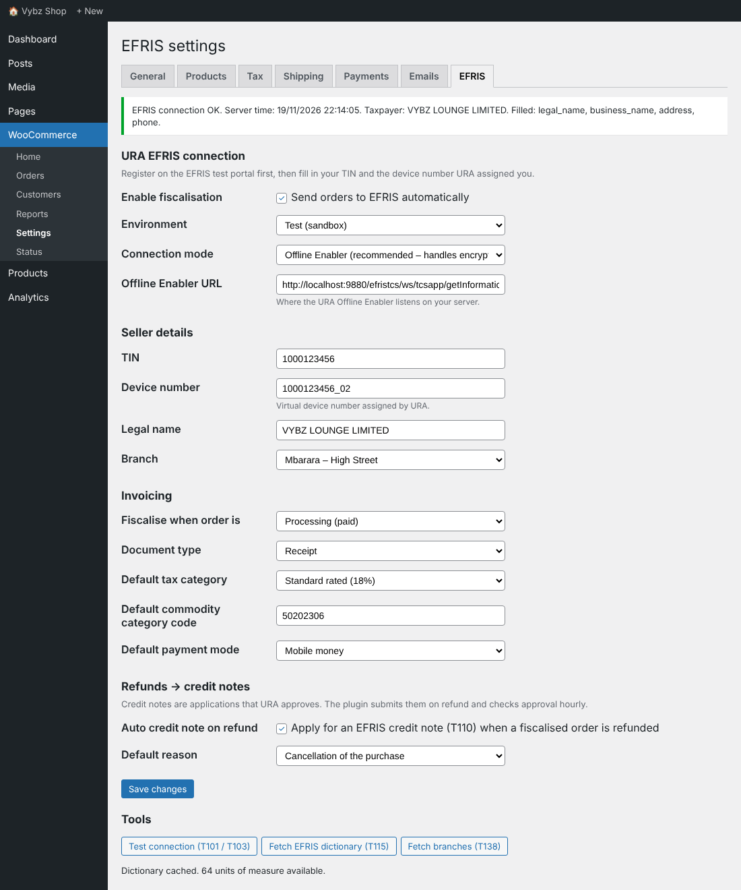
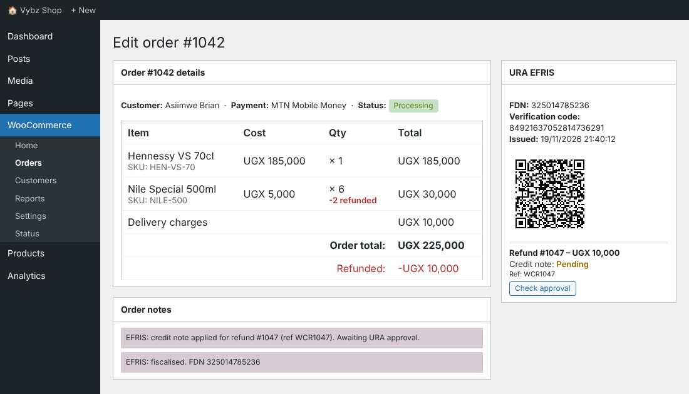
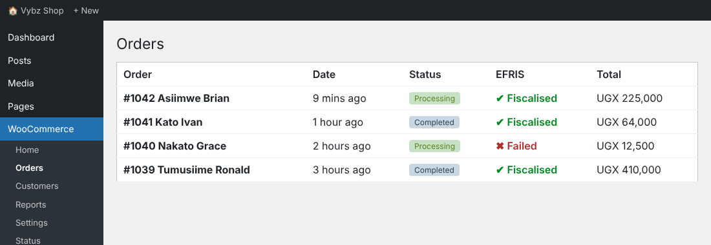
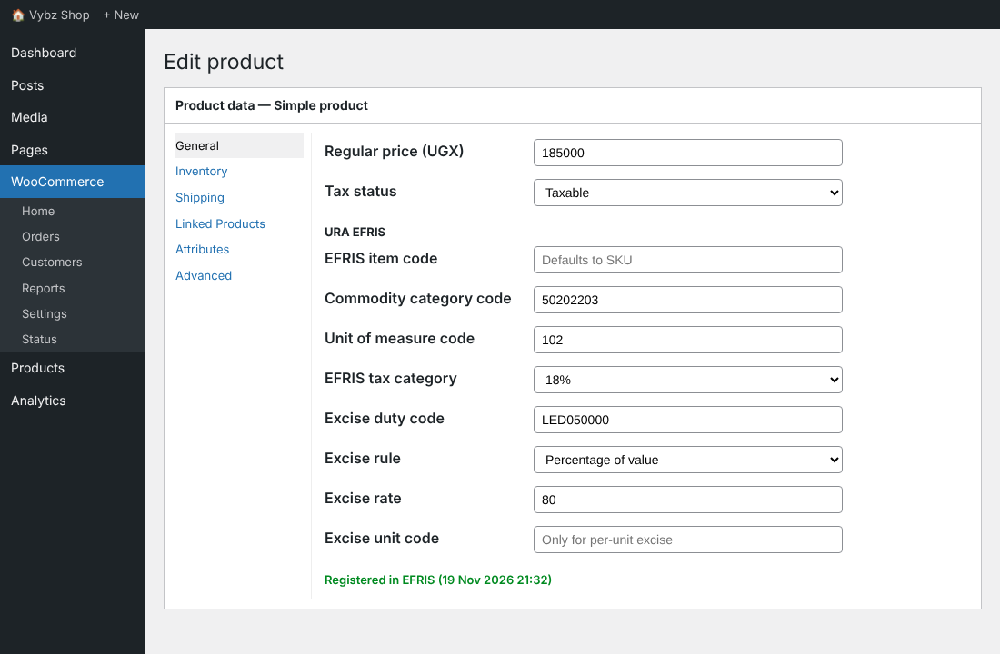
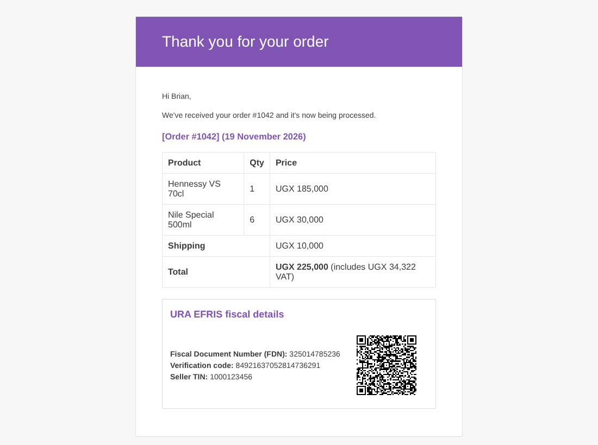

# Nexa EFRIS for WooCommerce

Connect a WooCommerce store to **URA EFRIS**, Uganda Revenue Authority's Electronic Fiscal Receipting and Invoicing Solution. The plugin registers your products, issues fiscal e-invoices or e-receipts for paid orders, applies for credit notes when you refund, and shows the **FDN, verification code and QR code** on orders and customer emails.

   

> [!WARNING]
> **Beta: test before you go live.** This plugin has **not** been certified by URA. Every business must run it against the EFRIS **test** environment and complete **User Acceptance Testing (UAT) with URA** before using it in production. See [Disclaimer](#disclaimer).

---

## Screenshots

| Settings | Order with EFRIS details |
|---|---|
|  |  |

| Orders list | Product EFRIS fields | Customer email |
|---|---|---|
|  |  |  |

*The screenshots are mockups of the plugin's admin screens with sample data.*

## Features

- **Two ways to connect:** URA's **Offline Enabler** (recommended), or the **direct API**, where the plugin does the AES encryption and SHA1withRSA signing itself and refreshes the key daily (T104).
- **One-click setup tools:** test the connection (T101/T103) and fill in your seller details from your EFRIS record, fetch the EFRIS dictionary (T115) and fetch your branches (T138).
- **Product registration (T130):** each product can have its own EFRIS item code, commodity category code, unit, tax category and excise duty. Variations are supported. Products register automatically on save or through a bulk action.
- **Optional automatic stock-in (T131)** before each sale.
- **Automatic fiscalisation (T109):** paid orders are sent to EFRIS in the background through Action Scheduler and retried up to 5 times with backoff. Each order's reference number is checked by EFRIS, so it can't be invoiced twice.
- **What goes on the invoice:**
  - VAT: standard (18%), zero-rated or exempt
  - Excise duty: a percentage of value or a fixed amount per unit
  - Shipping and fees as service lines
  - Negative fees, such as discounts, spread across the items
  - Orders in other currencies, with URA's exchange rate saved (T121)
  - B2B buyers (by TIN), B2C buyers and foreign buyers
- **Credit notes for refunds (T110):** the plugin applies automatically and checks every hour whether URA has approved (T111). It matches refunds by item quantity, shipping, fees and full refunds to the original invoice lines, and won't credit the same line twice.
- **Built-in QR code generator** with no third-party service. QR images are cached so they show in emails.
- **Buyer TIN field** at checkout, for both classic and block checkout.
- **Admin and customer display:**
  - an EFRIS box on each order, with a "Send to EFRIS now" button;
  - an EFRIS status column in the order list;
  - fiscal details in customer emails and My Account.
- **Compatibility:** works with WooCommerce's **HPOS** (custom order tables) and with checkout blocks.
- **Developer filters** for every request sent to EFRIS.

## Requirements

- WordPress 6.2+, WooCommerce 8.0+, PHP 7.4+ with the OpenSSL extension (and GD for QR images)
- A VAT-registered TIN set up for **system-to-system** integration on the EFRIS portal
- Either URA's Offline Enabler installed on the server, or (for direct mode) your private key file, with its public key uploaded to the EFRIS portal

## Installation

1. Download the latest `nexa-efris.zip` from [**Releases**](../../releases).
2. In WordPress, go to **Plugins → Add New → Upload Plugin**, choose the zip and activate it.
3. Go to **WooCommerce → Settings → EFRIS**.

## Setup

1. Register your TIN on the **EFRIS test portal** and note your device number.
2. Fill in your **TIN**, **device number** and **connection mode**, set **Environment = Test**, and save.
3. Click **Test connection**, then **Fetch EFRIS dictionary** (and **Fetch branches** if you have branches).
4. Set the default **commodity category code** and **unit code**. Set them per product wherever a product differs from the defaults.
5. Select your products, then choose **Bulk actions → Register in EFRIS**.
6. Place test orders and refunds, and check them on the EFRIS test portal.
7. Complete **UAT with URA**, then switch **Environment** to **Production**.

Logs are in **WooCommerce → Status → Logs** (source: `nexa-efris`). Turn on **Debug log** to see every request and response.

## Known limitations

- A partial refund entered only as an amount, with no item quantities, can't be matched to invoice lines. The plugin flags it so you can create that credit note on the EFRIS portal.
- Some field codes come from the public S2S API documentation. Check them against the latest API spec on your EFRIS portal during UAT:
  - `appId` / `version`
  - currency `101` = UGX
  - payment mode codes
  - excise rate format
  - credit note approval status codes
  - T121/T138 response fields

## Developer hooks

| Hook | Type | Purpose |
|---|---|---|
| `nexa_efris_invoice_payload` | filter | Modify the T109 invoice before sending |
| `nexa_efris_credit_note_payload` | filter | Modify the T110 credit note application |
| `nexa_efris_goods_payload` | filter | Modify the T130 product registration |
| `nexa_efris_stock_in_payload` | filter | Modify the T131 stock-in |
| `nexa_efris_payment_mode` | filter | Map payment gateways to EFRIS payment modes |
| `nexa_efris_item_code` | filter | Change how item codes are generated |
| `nexa_efris_qr_image_url` | filter | Use your own QR image URL |
| `nexa_efris_order_fiscalised` | action | Runs after an order gets its FDN |
| `nexa_efris_credit_note_applied` | action | Runs after a credit note application |

## Contributing

Bug reports and pull requests are welcome. See [CONTRIBUTING.md](CONTRIBUTING.md). If you've completed UAT with URA, please share any field corrections. They help every Ugandan merchant using the plugin.

## Disclaimer

This is an independent open-source project. It is **not affiliated with, endorsed by or certified by the Uganda Revenue Authority (URA)**. "EFRIS" and "URA" are used only to describe what the plugin connects to. The software is provided **"as is", without warranty of any kind** (see [LICENSE](LICENSE)). You are responsible for your own tax compliance and for testing the integration with URA before using it in production.

## License

[GPL-2.0-or-later](LICENSE) © Nexa Blaze

## Professional support

Need help with EFRIS onboarding, UAT or a custom integration? Open an issue or contact **Nexa Blaze**.
